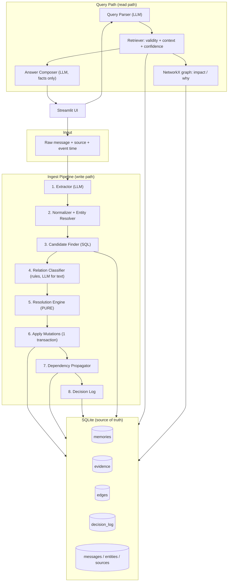
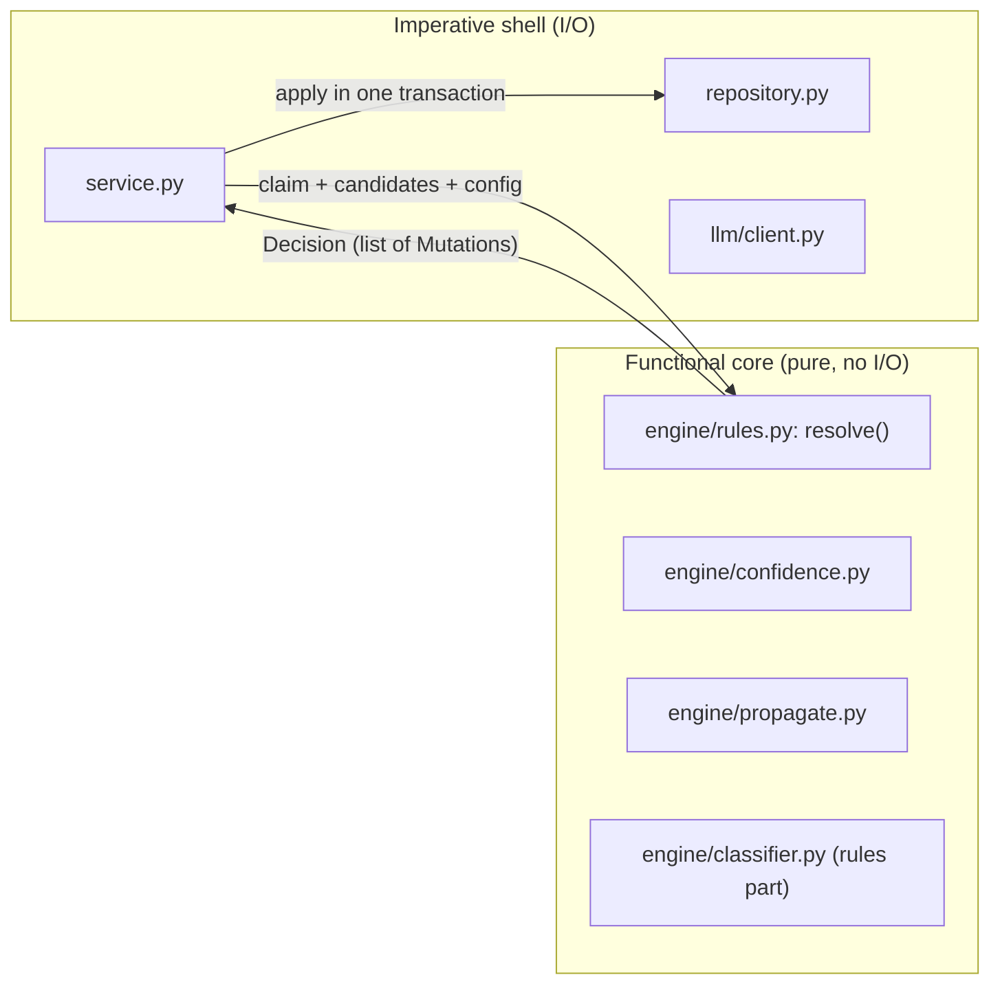
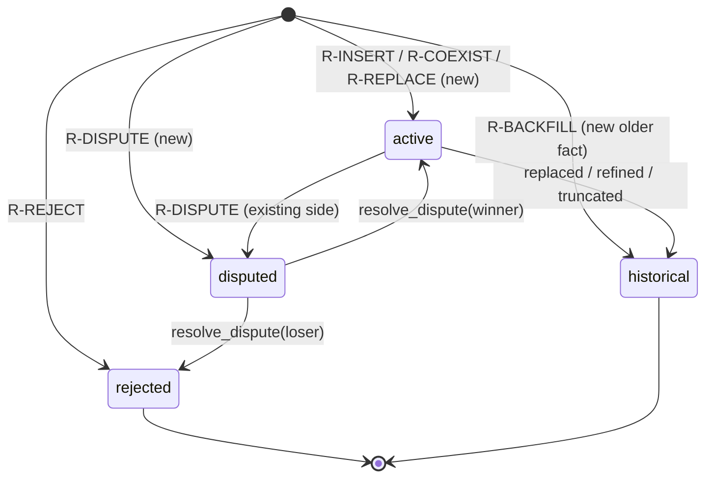
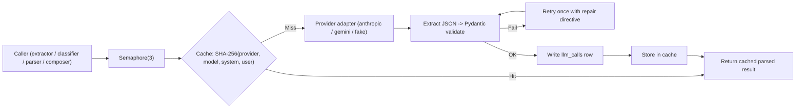

# MemoryMesh: System Architecture

## 1. High-Level Concept

MemoryMesh is a **write-time reconciliation** memory. Where a plain vector store keeps every message and lets the model sort it out at answer time, MemoryMesh resolves conflicts when information arrives, stores the outcome as a **bitemporal knowledge graph**, and answers questions from the resolved state.

---

## 2. Design Pattern: Functional Core, Imperative Shell

Why: the part that must be **correct and explainable** is testable with plain Python objects and no database, clock, or network. A bug in a decision becomes a failing unit test, not a mystery.

---

## 3. Write Path Contracts

Each stage has one job and a typed input/output (models in `SPECIFICATION.md`).

| # | Stage | Input | Output | Rules |
| :-: | :--- | :--- | :--- | :--- |
| 1 | Extractor | `IngestMessage` | `list[Claim]` | LLM, constrained to attribute catalog; may return `[]` |
| 2 | Normalizer / Entity Resolver | `Claim` | `ResolvedClaim` or `SKIP` | Normalize value by `value_type`; resolve subject to `entity_id`; unknown attribute -> `SKIP` |
| 3 | Candidate Finder | `ResolvedClaim` | `chain: list[Memory]` | All non-rejected memories for `(entity, attribute, context_key)` sorted by `valid_from`, with evidence |
| 4 | Relation Classifier | `(ResolvedClaim, Memory)` | `Relation` | Deterministic by value type; LLM only for `text` values |
| 5 | Resolution Engine | claim, chain, schema, source, config | `Decision` | Pure. Rules in `RESOLUTION_ENGINE.md` |
| 6 | Apply | `Decision` | DB state | Single transaction; inserts, updates, evidence, edges |
| 7 | Propagator | changed memory IDs + graph | `list[Mutation]` | BFS over reversed `depends_on` edges; flags `needs_review` |
| 8 | Decision Log | `Decision` + propagation | `decision_log` row | Always written, even for `SKIP` |

**Idempotency:** `messages` has a unique key on `(source_id, text_hash, event_time)`. A duplicate returns the earlier `IngestReport` and changes nothing.

**Ordering:** messages are processed in the order given, but the engine reasons by `valid_from`, not arrival order. Late-arriving older facts become `BACKFILL` (see engine doc).

---

## 4. Read Path

| Query intent | Parser output | Retrieval behavior |
| :--- | :--- | :--- |
| `current` | entity, attribute, context | Memories valid *now*, scope-matched, not rejected; most specific scope wins |
| `as_of` | + `valid_at` | Same, evaluated at `valid_at` |
| `history` | entity, attribute | All non-rejected memories ordered by `valid_from`; rejected claims returned separately as "rejected claims" |
| `why` | memory or entity+attribute | Evidence rows, source reliabilities, linked decision log entries, edges |
| `impact` | memory or entity+attribute | Reverse `depends_on` traversal (descendants) with reasons |
| `conflicts` | optional entity | All `disputed` memories grouped by contradiction pair |

**Belief-time queries** (optional parameter `known_at`): "what did we *believe* on 2 June?" uses `recorded_at <= known_at` and treats `valid_to` as unset when `closed_at > known_at`. See `SPECIFICATION.md` section 4.

**Composer boundary:** the LLM receives only the `QueryResult` JSON. It may not add facts. Cited memory IDs are validated against the IDs it was given; unknown IDs are stripped and logged.

---

## 5. Memory Status State Machine

`needs_review` is an **orthogonal flag**, not a status: a memory can be `active` and `needs_review` (a dependency changed underneath it).

---

## 6. Graph Model

SQLite stores relational rows; NetworkX is a **view** built from them for traversal and visualization.

- **Nodes:** `entity:{id}` and `mem:{id}` with attributes (status, confidence, value, validity).
- **Edges:**
  - `about`: `mem -> entity` (implicit, from `entity_id`)
  - `supersedes`: new memory -> old memory
  - `refines`: refined memory -> coarser memory
  - `contradicts`: new memory -> existing memory (stored once, treated as symmetric)
  - `depends_on`: dependent memory -> the memory it assumes

Impact analysis = `networkx.ancestors(G_depends, changed_node)` on the subgraph of `depends_on` edges (edges point dependent -> foundation, so dependents are ancestors).

---

## 7. LLM Wrapper

- Providers implement `complete(system, user, *, model, max_tokens) -> str`.
- `FakeProvider` returns scripted responses keyed by prompt ID and message text, so tests and CI are offline and deterministic.

---

## 8. Failure Modes & Handling

| Failure | Handling |
| :--- | :--- |
| LLM returns invalid JSON twice | `LLMOutputError`; message stored, `decision_log` row with `R-SKIP-LLMFAIL`; ingestion continues with next message |
| Extractor invents an unknown attribute | `R-SKIP-ATTR`; never auto-create attributes |
| Entity cannot be matched confidently | New entity created with `needs_review=1`; shown in UI |
| Classifier LLM unavailable for `text` values | Default relation `CONFLICTS`; explanation says "classifier unavailable" |
| DB write error mid-claim | Transaction rolls back; claim reported as failed; DB remains consistent |
| Two systems write at once | Out of scope; single-writer SQLite with WAL |

---

## 9. Architecture Decision Records

| ID | Decision | Rationale | Trade-off |
| :--- | :--- | :--- | :--- |
| **ADR-001** | SQLite + NetworkX, not Neo4j | Zero setup; temporal queries are plain SQL; graph is small | No native graph queries; fine at demo scale |
| **ADR-002** | Pure decision engine | Testable, explainable, repeatable | Slightly more plumbing (Decision/Mutation objects) |
| **ADR-003** | No LangGraph / agent framework | The pipeline is linear and deterministic; the only human-in-loop step (`resolve_dispute`) is a single service call | Less "agentic" branding; much less to debug |
| **ADR-004** | Streamlit, not React | One language; fastest path to graph + timeline + inspector | Less polished UI; acceptable for a demo |
| **ADR-005** | Vectorless write path (SQL + rapidfuzz) | Entity/attribute matching is structured; embeddings add install risk and opacity | Fuzzy aliases need curated alias table or LLM tie-break |
| **ADR-006** | Confidence derived from evidence (noisy-OR), recomputed not mutated | Auditable; corroboration cannot be double-counted | Slightly more compute per write |
| **ADR-007** | One row per claim with `valid_to`/`closed_at`, not full row versioning | Simple, still supports belief-time queries | Approximates full bitemporal history; documented limits |
| **ADR-008** | Naive-RAG baseline uses `fastembed` dense retrieval | A fair baseline must be a standard RAG, not a strawman | Extra dependency used only in eval |

---

## 10. Non-Goals (Explicit)

- Future-dated / planned facts (e.g. "will migrate on 1 December")
- Multi-user concurrent writes
- Arbitrary open-ended schemas (attributes come from `config/attributes.yaml`)
- Automatic learning of source reliability from outcomes (reliabilities are configured and visible)
- Fine-tuned NLI models (optional stretch only)
