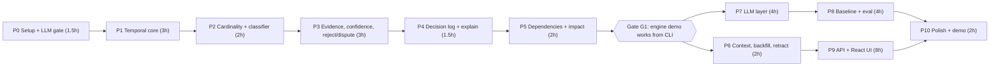

# MemoryMesh: Implementation Roadmap & Task Matrix

**Budget assumption:** about 32 focused hours (roughly 3 to 3.5 days solo, or 2 days for a pair; the React frontend and required API add about 4 hours over a Streamlit UI). If your time is shorter, apply the **cut hierarchy** in section 5. Phases 1-5 are the real project; everything after improves usability and proof.

---

## 1. Phase Overview

| Phase | Goal | Hours | Done when |
| :--- | :--- | :-: | :--- |
| P0 | Repo, config, schema, fake LLM, LLM smoke test, frontend scaffold | 1.5 | `make check` green; `make smoke` returns valid JSON (or you chose `fake`) |
| P1 | Insert, replace, validity windows, as-of query | 3 | 3.10 -> 3.12 works; "March?" returns 3.10 |
| P2 | Cardinality, normalization, classifier rules | 2 | Single vs multi behave differently; refine works |
| P3 | Sources, evidence, noisy-OR, reject, dispute | 3 | Intern claim rejected; wiki corroborates; mid-trust disputes |
| P4 | Decision log, explain | 1.5 | "Why" returns evidence + rule + scores |
| P5 | `depends_on`, propagation, impact | 2 | Migration flags Library X note |
| P6 | Context scopes, backfill, retract, `known_at` | 2 | Staging/global separated; late older fact backfills |
| P7 | Extractor, entity resolver, parser, composer, LLM client | 4 | Raw chat text -> same results as structured claims |
| P8 | Naive RAG baseline, 40 scenarios, metrics, ablations | 4 | `make eval` produces the comparison table |
| P9 | FastAPI layer + React pages (API 2h, UI 6h) | 8 | Full demo flow in the browser; `make types` clean |
| P10 | README, screencast, rehearsal | 2 | Pitch rehearsed twice; backup recorded |

---

## 2. Gates (Go/No-Go)

| Gate | When | Criteria | If failed |
| :--- | :--- | :--- | :--- |
| **G0** | End of P0 | `make smoke` gets valid JSON from the chosen provider, **or** you commit to `fake` for development and test a real provider before P7 | Switch provider; do not start P7 without a working provider |
| **G1** | End of P5 | CLI script `scripts/seed_demo.py` runs the hero scenario in structured mode and prints the correct four answers | Freeze new features; fix engine until it passes |
| **G2** | End of P8 | `make eval` produces a table in both modes | Run structured only; label e2e as "partial" |
| **Freeze** | 3h before submission | No new features; only bugs, README, recording | |

---

## 3. Task Matrix

Each task has an ID for commits (`feat(engine): ... [T3.2]`), an acceptance check, and the governing doc.

### P0: Setup
- [ ] **T0.1** Initialize repo, `pyproject.toml` (deps in AGENTS.md), `Makefile`, `.gitignore` (`.env`, `data/`, `.venv/`), `.env.example`, ruff config, pytest config. *Check:* `make check` passes on an empty test.
- [ ] **T0.2** Copy configs from `SPECIFICATION.md` section 5 into `config/*.yaml`; implement `config.py` loading into typed models. *Check:* test loads all YAMLs and validates.
- [ ] **T0.3** `schema.sql` + `db.py` (connect, create, reset). *Check:* creating DB twice is safe; foreign keys on.
- [ ] **T0.4** `models.py` exactly as `SPECIFICATION.md` section 1. *Check:* import and JSON round-trip tests.
- [ ] **T0.5** `llm/providers.py` (anthropic, gemini stub, fake) and `scripts/smoke_test_llm.py`. *Check:* G0.
- [ ] **T0.6** Scaffold `frontend/` (Vite + React + TypeScript strict + Tailwind + React Router + TanStack Query + React Flow + lucide-react), ESLint, `vite.config.ts` proxy `/api` -> `localhost:8000`, `make web`, `make web-check`. *Check:* `make web-check` passes; dev server shows a blank layout shell.

### P1: Temporal core
- [ ] **T1.1** `repository.py`: insert/get memory, add evidence, add edge, update memory fields (typed methods, one transaction helper). *Check:* CRUD tests on `:memory:` DB.
- [ ] **T1.2** `engine/rules.py` skeleton with `R-INSERT` and `R-REPLACE` using hard-coded trust (all sources 1.0 for now). *Check:* `test_r_insert_first_claim`, `test_r_replace_closes_window`.
- [ ] **T1.3** `retrieval/retrieve.py`: `current` and as-of query per `SPECIFICATION.md` 4.1. *Check:* `test_as_of_boundary`.
- [ ] **T1.4** `service.ingest_claims` (structured path) applying a `Decision` atomically. *Check:* service test: the Python 3.10 -> 3.12 example.
- [ ] **T1.5** Tiny CLI/notebook demonstrating T1.4 with printed memory table. *Check:* manual.

### P2: Cardinality and classification
- [ ] **T2.1** `ingest/normalize.py` for all value types. *Check:* table-driven tests (`"v3.12"`, `"Fridays"`).
- [ ] **T2.2** `engine/classifier.py` rule-based part (no LLM). *Check:* `test_r_refine_version_prefix`, `test_less_specific_is_identical`.
- [ ] **T2.3** Multi-valued path (`R-COEXIST`) and `R-REFINE`. *Check:* `test_r_coexist_multi`.
- [ ] **T2.4** Entity resolver tier 1 and 2 (normalized alias, rapidfuzz) with `entities.yaml`. *Check:* "srv-a" resolves to Server A; unknown name creates flagged entity.

### P3: Evidence, confidence, reject/dispute
- [ ] **T3.1** `engine/confidence.py` (strength, noisy-OR, decay, effective). *Check:* numeric tests from `RESOLUTION_ENGINE.md` section 8 (0.855, 0.958).
- [ ] **T3.2** `R-CORROBORATE`, `R-DUP-SAME-SOURCE`. *Check:* `test_r_corroborate_noisy_or`, `test_r_dup_same_source_no_boost`.
- [ ] **T3.3** Real trust in `R-REPLACE`; add `R-REJECT`, `R-DISPUTE`, margins from config. *Check:* `test_r_reject_low_trust`, `test_r_dispute_band`, `test_r_replace_blocked_by_margin`.
- [ ] **T3.4** Revert guard and history-conflict rule. *Check:* `test_revert_guard`, `test_history_conflict_never_rewrites`.
- [ ] **T3.5** `resolve_dispute` (4.5). *Check:* winner/loser statuses and windows.

### P4: Decision log and explain
- [ ] **T4.1** Repository + service write `decision_log` row for every claim, including SKIPs, inside the same transaction. *Check:* no code path ends without a row.
- [ ] **T4.2** `service.explain(memory_id)`: evidence, decisions, edges. *Check:* returns rule `R-REPLACE` and scores for the hero 3.12 memory.
- [ ] **T4.3** Invariant checker `tests/invariants.py` (AGENTS.md 3D) called at the end of every service test. *Check:* `test_invariants_after_scenarios`.

### P5: Dependencies
- [ ] **T5.1** Pipeline resolves `depends_on` references to memory IDs; engine emits `depends_on` edges. *Check:* hero m4 gets an edge to M1.
- [ ] **T5.2** `engine/propagate.py` + service integration; `R-PROPAGATE` log rows. *Check:* `test_propagate_transitive_cycle_safe`.
- [ ] **T5.3** `service.impact(memory_id)` read-only traversal with paths. *Check:* hero q4 returns Library X note.
- [ ] **T5.4** `service.acknowledge_review`. *Check:* flag cleared and logged.
- [ ] **G1 check:** `scripts/seed_demo.py` prints answers to q1-q7 in structured mode.

### P6: Context, backfill, retract
- [ ] **T6.1** Context key canonicalization and scope matching with specificity (`retrieval/context.py`). *Check:* `test_context_separates_chains`, staging query returns 3.11.
- [ ] **T6.2** `R-BACKFILL`. *Check:* `test_r_backfill_gap`.
- [ ] **T6.3** `R-RETRACT` + `R-SKIP-NOTARGET`. *Check:* `test_r_retract_closes_multi`.
- [ ] **T6.4** Belief-time (`known_at`) queries and `recorded_at` parameter on ingest. *Check:* `test_known_at_ignores_later_closure`.
- [ ] **T6.5** Idempotent ingest. *Check:* `test_idempotent_ingest`.

### P7: LLM layer
- [ ] **T7.1** `llm/client.py`: semaphore, SHA-256 cache, JSON extraction, retry once, call logging. *Check:* tests with fake provider incl. invalid-JSON-then-valid.
- [ ] **T7.2** Prompt files from `PROMPTS.md`; `ingest/extractor.py` + post-processing. *Check:* each few-shot example produces the documented JSON through `FakeProvider`; real-provider run on hero messages gives matching claims (manual check).
- [ ] **T7.3** LLM-backed `classify_relation` for text values with fallbacks. *Check:* low-confidence falls back; LLM failure falls back.
- [ ] **T7.4** `llm/query_parser.py` and `llm/composer.py` with post-validation (hallucinated citation stripping). *Check:* unit tests with fake provider.
- [ ] **T7.5** `service.ingest` (full e2e) and `service.ask`. *Check:* hero scenario e2e matches structured results on all 8 decisions.
- [ ] **T7.6** Entity tie-break (stretch S1).

### P8: Baseline and evaluation
- [ ] **T8.1** `baseline/naive_rag.py` (fastembed top-5 + `baseline_answer`). *Check:* answers hero q1 with the same `FinalAnswer` schema.
- [ ] **T8.2** `eval/run_eval.py` + `metrics.py` for both modes and ablation flags. *Check:* runs the hero scenario and prints metrics.
- [ ] **T8.3** Write 39 more scenarios across categories (section 3 of EVALUATION doc). *Check:* every scenario passes the schema check; at least 3 designed-to-lose included.
- [ ] **T8.4** Report generator (`report.md`, `results.json`). *Check:* G2.

### P9: API + React UI
*API first (T9.1), then pages. Each page task is done when `make web-check` passes and you have used the page against the running API.*
- [ ] **T9.1** FastAPI layer per `SPECIFICATION.md` section 7 (lifespan creates `MemoryService`, CORS, error handlers, all routers except SSE), OpenAPI export, `make api`, `make types`. *Check:* `/docs` lists all endpoints; `pytest tests/api` passes with `TestClient` and the fake LLM (one test per router).
- [ ] **T9.2** App shell: sidebar, header (demo clock, provider badge from `/health`, Reset demo), `api/client.ts`, `api/hooks.ts`, shared components (`StatusBadge`, `ConfidenceBar`, `ValidityBar`, `EmptyState`, `ErrorState`). *Check:* shell loads and shows provider badge.
- [ ] **T9.3** Ingest page with `DecisionCard`; Memories page with filters. *Check:* ingest two hero messages, see `R-INSERT` then `R-REPLACE` cards.
- [ ] **T9.4** Provenance drawer (`ProvenancePanel`) usable from any `M<id>`; Ask page with citations and **compare with naive RAG** toggle. *Check:* hero q1 shows MemoryMesh vs baseline columns.
- [ ] **T9.5** Graph page (React Flow, styled edges) and Timeline page (custom lanes, validity bars, rejected markers). *Check:* hero scenario renders; supersedes and depends_on edges visible.
- [ ] **T9.6** Review page (dispute pick-winner, acknowledge) and Decisions page (rule filter). *Check:* resolving the deploy-day dispute updates statuses.
- [ ] **T9.7** SSE replay endpoint + `replay.ts`; Ingest page **Replay hero scenario** button. *Check:* decision cards appear one by one.
- [ ] **T9.8** LLM Inspector, Evaluation, Settings pages. *Check:* each shows data from its endpoint with loading/error/empty states.

### P10: Polish
- [ ] **T10.1** README quick start verified from a clean clone.
- [ ] **T10.2** Screencast backup; slides with the real eval table.
- [ ] **T10.3** Rehearse pitch twice, timing under 3:00.
- [ ] **T10.4** Final `make check`, clean git history, `.env.example` verified, no secrets committed.

---

## 4. Parallel Tracks (if 2-3 people)

Freeze `models.py` and `SPECIFICATION.md` after T0.4. Then:

| Track | Owner | Tasks |
| :--- | :--- | :--- |
| **A: Engine** | Person 1 | P1 -> P2 -> P3 -> P4 -> P5 -> P6 |
| **B: LLM & Eval** | Person 2 | T7.1-T7.4 using the fake provider; then P8 once engine hits G1 |
| **C: Frontend & Demo** | Person 3 | T0.6, then P9 UI tasks against the REST contract using mock responses (MSW or static JSON) from day 1; swap to the real API after T9.1; P10 |

Integration points: `MemoryService` signatures in `SPECIFICATION.md` section 2. Track C can build every page against mocked API responses (shaped by `SPECIFICATION.md` section 7) and then against seeded data before the LLM layer exists. Types generated from the backend OpenAPI (`make types`) keep both sides honest.

---

## 5. Cut Hierarchy

If time runs short, cut in this order (earliest first). **Never cut the "do not cut" list.**

1. Settings page and the draggable "as of" timeline cursor
2. Entity tie-break LLM (S1) and dispute auto-resolution (S3)
3. Decay / half-life support
4. Evaluation page in the UI (show the static `report.md` screenshot instead)
5. `known_at` belief-time queries
6. SSE replay (use a "load scenario" button that ingests all messages at once)
7. Ablations A4/A5 (keep A1-A3)
8. Reduce scenarios from 40 to 25 (keep all categories represented)

*Note: the REST API is no longer cuttable; the React frontend depends on it.*

**Do not cut:**
- Validity windows with replace (`R-REPLACE`)
- Trust-based reject/dispute
- Decision log and "why"
- Dependency flagging and impact
- Naive-RAG comparison on at least the hero scenario plus 15 others
- LLM Inspector page (proves the LLM does real, bounded work)

---

## 6. Risk Register

| Risk | Likelihood | Mitigation |
| :--- | :-: | :--- |
| LLM extraction flakiness | High | Strict schema, few-shot, catalog-constrained attributes, retry once, structured-mode fallback for demo |
| Entity resolution errors | Medium | Curated alias table; flagged new entities instead of silent merges |
| Time/timezone bugs | Medium | UTC only, single string format, boundary tests early (T1.3) |
| Arbitrary thresholds look rigged | Medium | Freeze before eval; show formulas; include designed-to-lose cases |
| Scope creep | High | Phase gates; cut hierarchy; agent instructed to stay within current task |
| Agent produces plausible but wrong engine code | High | Pure-function tests per rule; numeric examples from `RESOLUTION_ENGINE.md` as tests |
| API quota / outage on demo day | Medium | `fake` provider + seeded DB; backup screencast |
| API/frontend type drift | Medium | Generate `types.ts` from OpenAPI on every backend model change (`make types`); CI-style `make web-check` catches breaks |
| Frontend time sink (styling) | High | Tailwind only, fixed status colors, no custom design system; cut order items 1, 4, 6 |
| Beginner overload | Medium | Study topics just-in-time per phase (see `VIBECODING_GUIDE.md` section 6) |
